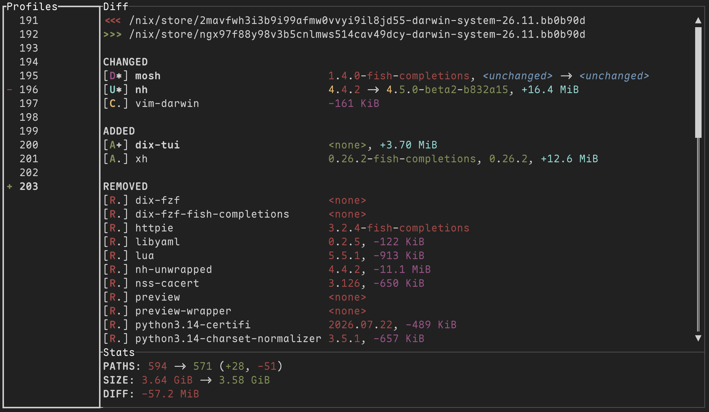

# dix-tui

TUI app for comparing nix systems using [dix](https://github.com/manic-systems/dix).



## Usage

- Navigation: Use arrow keys, h/j/k/l or Tab to move around panes, select system profiles and scroll the diff output
- Pinning the "old" profile: Press Space to pin the "old" profile and compare with any "new" profile by navigating to it
  - "Old" profile: marked with `-`
  - "New" profile: marked with `+`
  - When old = new: marked with `=` (this always produces an empty diff)
- When "old" is not pinned: it follows the "new" profile selection, by comparing against the previous profile, i.e. new=200, old=199

## Installation

To quickly run from source in a shell:

```bash
nix run github:Daste745/dix-tui
nix shell github:Daste745/dix-tui
```

### System configuration

Add `dix-tui` to your flake inputs:

```nix
inputs.dix-tui = {
  url = "github:Daste745/dix-tui";
  inputs.nixpkgs.follows = "nixpkgs";  # Optional
};
```

Then, add `dix-tui` to system packages:

```nix
# Assuming `inputs` is passed via `specialArgs`
{ inputs, pkgs, ... }:
let
  inherit (pkgs.stdenv.hostPlatform) system;
in
{
  environment.systemPackages = [
    inputs.dix-tui.packages.${system}.default
  ];
}
```

## Feature plans

- [ ] More recognizabla profile names (e.g. date)
- [ ] Keyboard shortcut hints (at the bottom?)
- [ ] Easier diff navigation (collapsible sections)
- [x] Total numbers next to "CHANGED", "ADDED", "REMOVED" sections - added in [dix 3.0.0](https://github.com/manic-systems/dix/releases/tag/v3.0.0)
- [ ] More info in diff pane header (e.g. "new # -> old #")
- [ ] Historical diffs for deleted profiles (using [dix snapshots](https://github.com/manic-systems/dix#snapshots)?)
